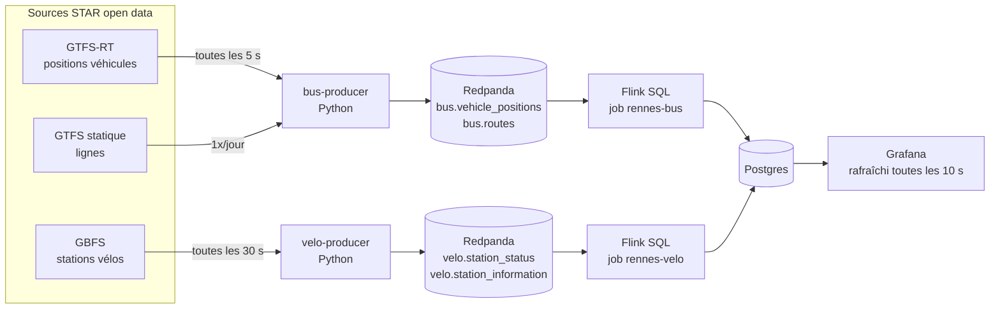

# Rennes en temps réel : bus, métro et vélos STAR

Pipeline de streaming de bout en bout sur les données ouvertes du réseau STAR (Rennes Métropole) :
positions des bus et du métro (GTFS-RT) et disponibilité des vélos en libre-service (GBFS),
traitées en continu avec **Redpanda** (Kafka) et **Flink SQL**, servies par **Postgres** et affichées en direct dans **Grafana**.

Tout tourne avec `docker compose` sur une seule machine.

## Architecture



| Étape | Rôle |
| --- | --- |
| Producteurs | Interrogent les flux, normalisent (GBFS 2.x et 3.x, protobuf GTFS-RT), **ne publient que ce qui a changé**, clé Kafka = id du véhicule ou de la station |
| Redpanda | Broker compatible Kafka, topics de données (rétention 3 à 7 jours) et topics référentiels compactés |
| Flink SQL | Temps d'événement avec watermarks, état par clé, fenêtres glissantes, exactly-once via checkpoints |
| Postgres | Tables de service upsertées par Flink, vues pour le dashboard |
| Grafana | Carte des bus et des stations, latence mesurée, activité par ligne, alertes |

## Ce que calcule Flink

**Bus et métro** (`flink/sql/bus.sql`)
- dernière position de chaque véhicule, avec **vitesse déduite** de deux positions successives (`LAG` par véhicule) quand le flux ne la fournit pas, et filtrage des sauts GPS ;
- activité par ligne en fenêtres d'une minute : véhicules en service, vitesse moyenne ;
- âge des positions à l'ingestion, par minute, pour distinguer la latence due à la source de celle du pipeline.

**Vélos** (`flink/sql/velo.sql`)
- état courant de chaque station ;
- disponibilité moyenne, min et max par station en fenêtres de 5 minutes ;
- **départs et arrivées estimés** à partir des variations de stock entre deux mesures ;
- alertes quand une station devient vide ou pleine.

## Temps réel : ce qui est mesuré

Le dashboard affiche deux latences distinctes, calculées sur chaque événement :

- **latence du pipeline** (lecture par le producteur → écriture dans Postgres par Flink) : de l'ordre de quelques dizaines de millisecondes ;
- **latence de bout en bout** (horodatage de la position GPS → Postgres) : dépend surtout de la fréquence de publication de la source.

Le flux vélos GBFS du STAR n'est republié qu'environ une fois par minute : c'est une limite de la source, pas du pipeline.
C'est pour ça que le projet s'appuie aussi sur les positions GTFS-RT des bus, beaucoup plus fréquentes.
Le producteur bus journalise la cadence réelle observée (`docker compose logs bus-producer`).

## Lancer en local

```bash
cp .env.example .env
docker compose up -d --build
```

- Dashboard : http://localhost:3000 (lecture anonyme ; admin / mot de passe du `.env`)
- Flink UI : http://localhost:8081
- Redpanda Console : `docker compose --profile debug up -d console` puis http://localhost:8080

### Sans réseau : simulateur

`mock-star/` simule 40 stations vélos et 30 bus qui roulent autour de Rennes, au même format que les vrais flux.
Décommenter les trois URL `mock-star` dans `.env`, puis :

```bash
docker compose --profile mock up -d --build
```

### Tests

```bash
cd producer && pip install -r requirements.txt pytest && pytest
```

## Déploiement

Voir [deploy/scaleway.md](deploy/scaleway.md) : une instance Ubuntu avec 8 Go de RAM et un script d'installation.

## Choix techniques

- **Redpanda plutôt qu'Apache Kafka** : même protocole, un seul binaire sans ZooKeeper ni JVM, adapté à un seul serveur.
- **Flink SQL** : le traitement reste lisible en SQL tout en profitant du temps d'événement, des watermarks et de l'état géré.
  Chaque fichier de `flink/sql/` est un job ; `flink/submit.sh` ne resoumet pas un job déjà en cours.
- **Publication des seuls changements** : divise le volume par 5 à 10 côté vélos, et garantit qu'un événement correspond à une vraie mesure.
- **Offsets commités aux checkpoints** (`group-offsets`) : un job resoumis reprend là où il s'était arrêté.
- **Gotcha** : le connecteur Kafka de Flink n'embarque pas zstd, les producteurs compressent donc en gzip.

## Données

Données © STAR / Rennes Métropole, sous licence [ODbL](https://opendatacommons.org/licenses/odbl/) :
[vélos GBFS](https://data.gouv.fr/datasets/velo-en-libre-service-du-star-au-standard-gbfs),
[GTFS et GTFS-RT](https://www.data.gouv.fr/datasets/versions-des-horaires-theoriques-des-lignes-de-bus-et-de-metro-du-reseau-star-au-format-gtfs).
